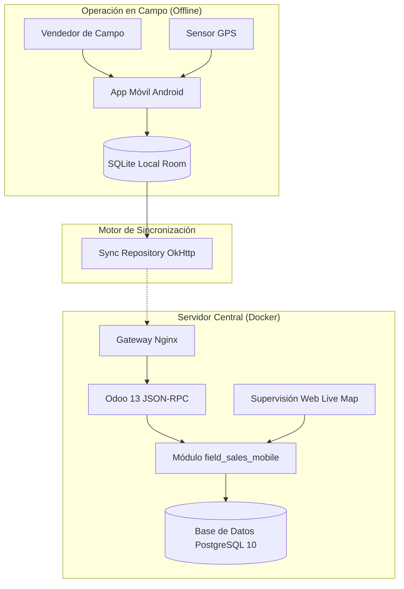

# Proyecto Inveragro - Sistema de Preventa Agrícola, Geocercas y Telemetría en Campo

[](mobile-app/)
[](backend/)
[](backend/docker-compose.yml)
[](backend/)
[](docs/arquitectura.md)

Proyecto de grado / Capstone de Ingeniería enfocado en la transformación digital y optimización de las operaciones de preventa técnica en campo para el sector agroindustrial. Integra una **aplicación móvil Android nativa (Offline-First)** con el sistema **ERP Odoo 13 en contenedores Docker**, permitiendo el registro de visitas, validación geodésica de predios rurales y emisión de pedidos en zonas con nula o intermitente conectividad celular.

---

## 📌 Problemática y Contexto Operativo
En el sector agrícola peruano (valles de Ica, Chincha y Cañete), los ingenieros agrónomos y representantes comerciales visitan fundos ubicados en zonas con cobertura de red inestable o inexistente. Las soluciones convencionales dependientes de conexión constante fallan en el registro de pedidos y no permiten verificar la presencia física del vendedor en el fundo asignado.

**Inveragro Vendedores** resuelve esta brecha mediante:
1. **Persistencia Local y Resiliencia (Offline-First):** Catálogo de fertilizantes, semillas y clientes almacenados localmente en SQLite mediante Android Room.
2. **Validación de Geocerca (Haversine):** Comprobación geodésica rigurosa que impide el inicio de la visita si el dispositivo está fuera del radio permitido (tolerancia menor a 1 metro).
3. **Telemetría y Sincronización Automática:** Encolamiento seguro de transacciones (`external_uuid`) y sincronización atómica idempotente cuando se recupera conectividad.
4. **Supervisión Satelital en Tiempo Real:** Módulo web para supervisores en Odoo con mapa interactivo y tracking de telemetría de vendedores en campo.

---

## 🏛️ Arquitectura General



---

## 📂 Estructura del Repositorio

El repositorio unifica el ecosistema completo del proyecto en dos capas modulares:

```
Proyecto-Inveragro---Capstone/
│
├── backend/                             # Servidor Backend ERP (Docker & Odoo)
│   ├── docker-compose.yml               # Orquestación de servicios Odoo 13 y PostgreSQL 10
│   ├── config/                          # Archivos de configuración de Odoo (odoo.conf)
│   └── addons/
│       └── field_sales_mobile/          # Módulo custom de Odoo (Modelos, Vistas, API JSON-RPC)
│           ├── controllers/             # Enrutadores de endpoints para la app móvil
│           ├── models/                  # Modelos de datos (visitas, pedidos, telemetría, clientes)
│           ├── views/                   # Vistas XML y mapa satelital en vivo
│           └── security/                # Reglas de acceso y perfiles de usuario
│
├── mobile-app/                          # Aplicación Móvil Android Nativa
│   ├── build.gradle                     # Configuración de compilación raíz
│   ├── local.properties.example         # Plantilla para configuración del SDK local
│   └── app/
│       ├── build.gradle                 # Dependencias (Room, Retrofit, Maps, FusedLocation)
│       └── src/
│           ├── main/
│           │   ├── AndroidManifest.xml  # Permisos, servicios y metadata de la app
│           │   ├── java/                # Código fuente Java (Activities, Fragments, DAOs, Repos)
│           │   └── res/                 # Layouts XML, estilos, paleta de colores y recursos
│           └── test/                    # Suite de pruebas unitarias
│
├── docs/                                # Documentación Técnica y de Ingeniería
│   ├── arquitectura.md                  # Descripción detallada de la arquitectura de software
│   ├── api_endpoints.md                 # Contrato completo de la API JSON-RPC
│   └── guia_instalacion.md              # Paso a paso para levantar el entorno local
│
├── .gitignore                           # Exclusión de compilados, caches y datos locales
└── README.md                            # Documentación principal del proyecto
```

---

## 🚀 Puesta en Marcha Rápida

### 1. Iniciar el Backend (Docker)
```bash
cd backend
docker-compose up -d
```
* Servidor Odoo disponible en: [http://localhost:8069](http://localhost:8069)
* Credenciales por defecto de desarrollo: Usuario `admin` | Password `admin`

### 2. Compilar la Aplicación Móvil (Android)
```bash
cd mobile-app
./gradlew assembleDebug
```
* El APK compilado se encontrará en `mobile-app/app/build/outputs/apk/debug/app-debug.apk`.

> Para instrucciones detalladas de configuración de emuladores y conexión Wi-Fi, consulta la [Guía de Instalación](docs/guia_instalacion.md).

---

## 🔒 Seguridad y Privacidad de la Información
Este repositorio fue auditado y preparado conforme a las buenas prácticas de seguridad para repositorios públicos y académicos:
* **Sin Credenciales Expuestas:** No se incluyen certificados de firma de producción (`.jks`/`.keystore`), credenciales corporativas ni API keys privadas en el código fuente.
* **Google Maps API Key:** La clave de mapas se referencia mediante el recurso `@string/google_maps_key` en `strings.xml`, permitiendo al desarrollador inyectar su propia credencial de Google Cloud sin comprometer secretos en el repositorio.
* **Cifrado Criptográfico:** Contraseñas hasheadas en base de datos (`PBKDF2/SHA-256`) y tokens de sesión móviles generados de forma pseudoaleatoria criptográficamente segura (`secrets.token_urlsafe`).
* **Plantillas Seguras:** Configuraciones locales de SDK y variables de entorno se suministran como archivos de ejemplo (`.example`).

---

## 👨‍💻 Autores y Agradecimientos
* **Aldair Te** - Desarrollo e Integración Capstone
* Proyecto desarrollado para fines académicos y de titulación profesional en Ingeniería.
