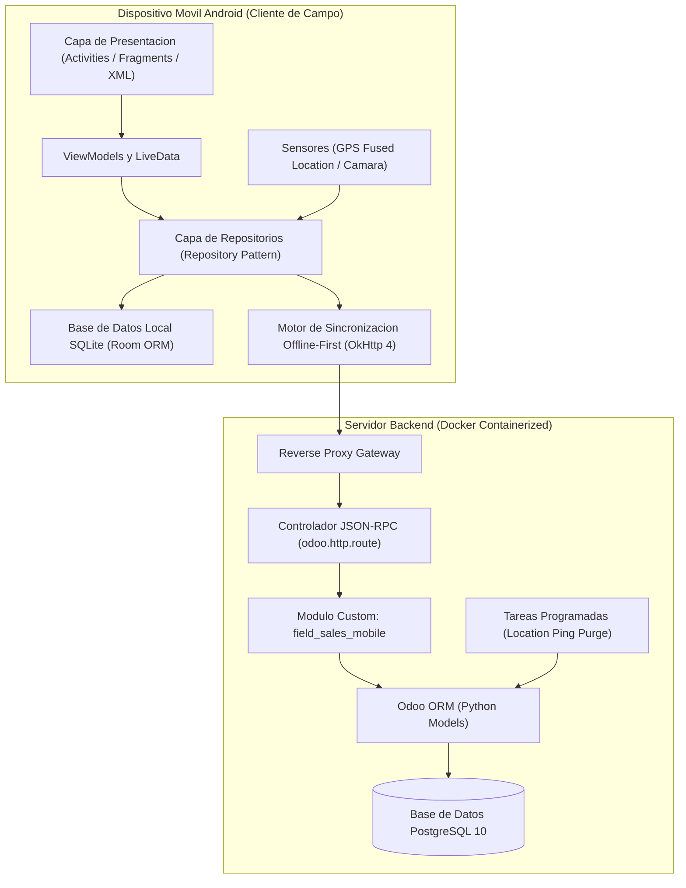

# Arquitectura del Sistema - Inveragro Vendedores

## 1. Visión General
El proyecto **Inveragro Vendedores (Field Sales Mobile & ERP)** es una solución integral de preventa, telemetría y supervisión de rutas agrícolas diseñada para operar bajo el paradigma **Offline-First**. 

La arquitectura desacopla la persistencia de datos en el cliente móvil respecto a la conectividad con el servidor central ERP Odoo 13, permitiendo a los ingenieros agrónomos y vendedores registrar visitas, validar geocercas en zonas rurales sin cobertura y emitir pedidos que se sincronizan atómicamente cuando el dispositivo recupera señal.

---

## 2. Diagrama de Arquitectura

---

## 3. Principios de Diseño y Componentes Clave

### 3.1. Patrón Offline-First y Persistencia Local
* **Room SQLite:** Almacenamiento local estructurado para clientes, rutas, catálogo de fertilizantes/semillas, pedidos y visitas.
* **Marcado Atómico:** Cada transacción creada en offline recibe un `external_uuid` (UUID v4) y bandera `sincronizado = false`.
* **Idempotencia:** Odoo verifica el `external_uuid` en la inserción; si el paquete fue recibido previamente debido a reintentos de red, se actualiza sin duplicar registros.

### 3.2. Geocercas Geodésicas y Algoritmo de Haversine
Para garantizar que el vendedor realmente se encuentre en el predio agrícola antes de permitir el inicio de la visita técnica:
$$d = 2R \arcsin \left( \sqrt{\sin^2\left(\frac{\Delta \varphi}{2}\right) + \cos(\varphi_1)\cos(\varphi_2)\sin^2\left(\frac{\Delta \lambda}{2}\right)} \right)$$
* $R = 6371000\text{ m}$ (Radio medio de la Tierra).
* Si la distancia $d \le 50\text{ m}$ (o radio configurado por la empresa), la geocerca se valida exitosamente y habilita el botón de inicio de visita.

### 3.3. Seguridad y Privacidad
* **Tokens Criptográficos de Sesión:** Tras el login exitoso, Odoo expide un Bearer token aleatorio generado con `secrets.token_urlsafe(32)`.
* **Cifrado de Credenciales:** Las contraseñas en el backend se procesan con `werkzeug.security.generate_password_hash` (PBKDF2 con SHA-256).
* **Login Offline Seguro:** El hash de verificación local en SQLite se deriva de las credenciales previamente validadas con el servidor, impidiendo accesos no autorizados si el equipo es reiniciado sin internet.
* **Sin Datos Sensibles Expuestos:** No se almacenan contraseñas en texto plano ni se transmiten llaves maestras en las solicitudes.
